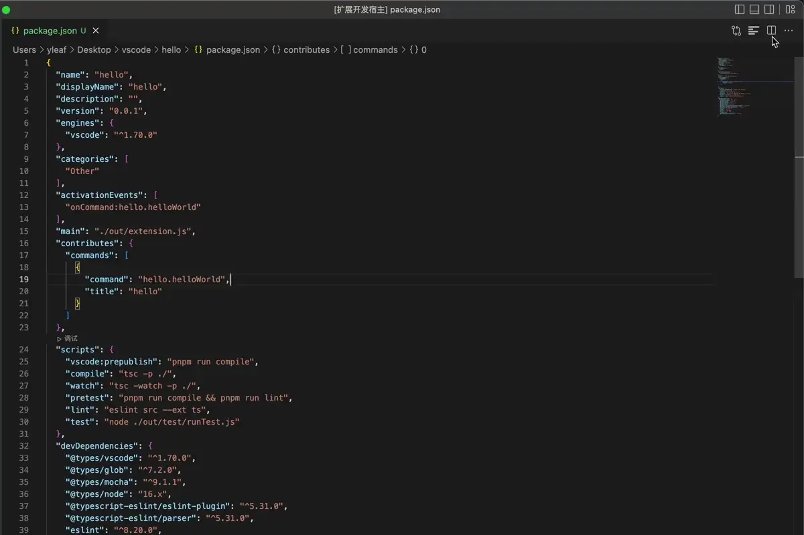

# jsonPath README
## Features

show JSONPath when you click the key value in JSON file. And you can collapse the JSON by click the icon.

String values are rendered as plain text in the preview, so embedded HTML-like content stays visible without being interpreted as markup.

## Release Notes

see [CHANGELOG.md](CHANGELOG.md)
